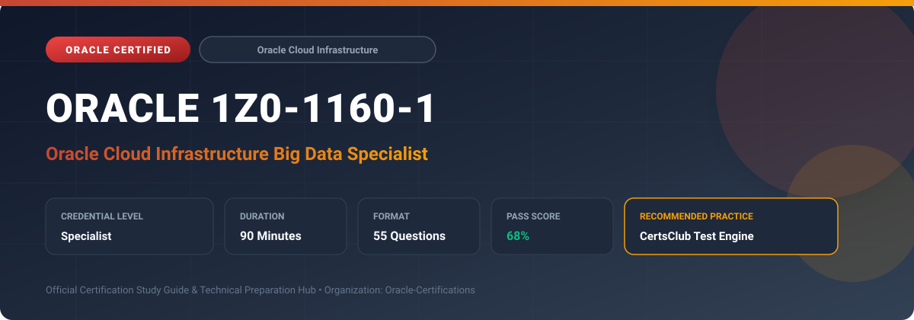

  

# Oracle 1Z0-1160-1: Oracle Cloud Infrastructure Big Data Specialist

---

## 1. Exam Overview & Candidate Profile

The **Oracle 1Z0-1160-1: Oracle Cloud Infrastructure Big Data Specialist** credential validates big data engineers proficient in architecting, deploying, and securing enterprise Hadoop, Spark, and analytics clusters on OCI.

Candidates validate expertise across OCI Big Data Service (BDS), Apache Hadoop, Spark, Hive, Trino/Presto, OCI Data Flow, Kerberos authentication, Apache Ranger authorization, and Object Storage data lake connectors.

### Target Audience & Prerequisites
- **Target Roles**: Implementation Specialists, Cloud Architects, Technical Leads, Enterprise Consultants, and Systems Engineers.
- **Recommended Experience**: 1–2 years of practical, hands-on experience designing, implementing, and maintaining corresponding Oracle solutions.
- **Credential Earned**: Specialist Certification.

---

## 2. Key Exam Specifications

| Specification | Details |
| :--- | :--- |
| **Exam Code** | **Oracle 1Z0-1160-1** |
| **Official Title** | Oracle Cloud Infrastructure Big Data Specialist |
| **Certification Track** | Oracle Cloud Infrastructure |
| **Exam Duration** | 90 Minutes |
| **Number of Questions** | 55 Questions |
| **Passing Score** | 68% |
| **Question Format** | Multiple Choice (Single/Multiple Answer), Scenario-Based Questions |
| **Delivery Provider** | Oracle University / Pearson VUE (Online Proctored or Test Center) |
| **Recommended Practice Engine** | [CertsClub Oracle Practice Tests](https://www.certsclub.com/oracle/1z0-1160-1-dumps.html) |

---

## 3. Official Blueprint & Exam Domain Breakdown

The examination assesses candidate competencies across core functional domains weighted as follows:

| Domain Area | Weighting |
| :--- | :--- |
| **OCI Big Data Service (BDS) Architecture & Sizing** | `25%` |
| **Hadoop Ecosystem Administration (HDFS, YARN, Hive, Spark)** | `25%` |
| **Data Lake Architecture & OCI Object Storage Connectors (BOSH)** | `20%` |
| **Big Data Security (Kerberos, Apache Ranger, TLS Encryption)** | `15%` |
| **Cluster Scaling, Performance Tuning & Job Monitoring** | `15%` |

---

## 4. Deep Dive into Complex & Challenging Technical Topics

To secure a passing score on the 1Z0-1160-1 exam, candidates must master the following advanced concepts:

- Provisioning Highly Available OCI Big Data Service clusters with dedicated master, utility, and worker nodes.
- Integrating OCI Object Storage directly into Hadoop/Spark workflows using the BOSH connector (hdfs:// vs oci://).
- Enforcing enterprise security with Active Directory/LDAP Kerberos authentication and Apache Ranger fine-grained authorization.
- Configuring YARN capacity schedulers, queue management, and resource allocation across concurrent Spark jobs.
- Auto-scaling worker node pools horizontally based on processing demand to optimize cloud spend.

---

## 5. Scenario-Based Demo & Practice Questions

### Question 1
What connector protocol enables Hadoop and Spark jobs on OCI Big Data Service to read and write directly to OCI Object Storage buckets without staging data on local HDFS disks?

A) BOSH (Big Data Open Source Software on Hadoop) / oci:// protocol
B) FTP over SSL
C) NFS v3 Local Mount
D) SMB Network Share

- **Correct Answer**: `A) BOSH (Big Data Open Source Software on Hadoop) / oci:// protocol`  
- **Technical Explanation**: The OCI HDFS connector (BOSH) enables native `oci://` URI addressing, allowing Spark and Hadoop engines to stream data directly to and from OCI Object Storage.

---

### Question 2
Which security framework provides centralized, fine-grained access control policies and column-level masking across Hive and Spark SQL tables in OCI Big Data Service?

A) Apache Ranger
B) Linux iptables
C) VCN Route Table
D) Bastion Port Forwarding

- **Correct Answer**: `A) Apache Ranger`  
- **Technical Explanation**: Apache Ranger is integrated into OCI Big Data Service to provide centralized security administration, resource-based policies, and column/row-level filtering across Hadoop ecosystem components.

---

## 6. Recommended Preparation Strategy & Practice Testing Engine

Achieving certification in **Oracle 1Z0-1160-1** requires balanced theoretical study and scenario-based simulation practice:

1. **Review Oracle Documentation**: Master architecture guides, implementation workbooks, and administration manuals on the Oracle Help Center.
2. **Hands-on Lab Practice**: Execute real-world configuration, policy setup, and troubleshooting tasks in your cloud tenancy or test instance.
3. **Simulated Exam Drills**: Practice answering timed, scenario-based multiple-choice questions to familiarize yourself with the question formats, traps, and timing constraints.

### Practice With CertsClub
For realistic practice questions, updated dumps, and mock testing environments:
- **Resource**: [CertsClub Oracle Practice Test Engine](https://www.certsclub.com/oracle/1z0-1160-1-dumps.html)
- **Special Discount**: Use coupon code **`club20`** during checkout for an instant **20% discount** on all practice exam bundles and testing engines.

---

## 7. Official Documentation & References

- [Oracle University Certification Registry](https://education.oracle.com/)
- [Oracle Help Center Documentation Portal](https://docs.oracle.com/)
- [Oracle Cloud Infrastructure & Applications Guides](https://docs.oracle.com/en/cloud/)
- [CertsClub Oracle Certification Exam Practice](https://www.certsclub.com/oracle/1z0-1160-1-dumps.html)

---

## 8. SEO & Discovery Keywords

`oracle 1z0-1160-1, oracle 1z0-1160-1 exam, oracle 1z0-1160-1 dumps, 1Z0-1160-1 practice questions, 1Z0-1160-1 study guide, oracle cloud infrastructure big data specialist, certsclub 1z0-1160-1`